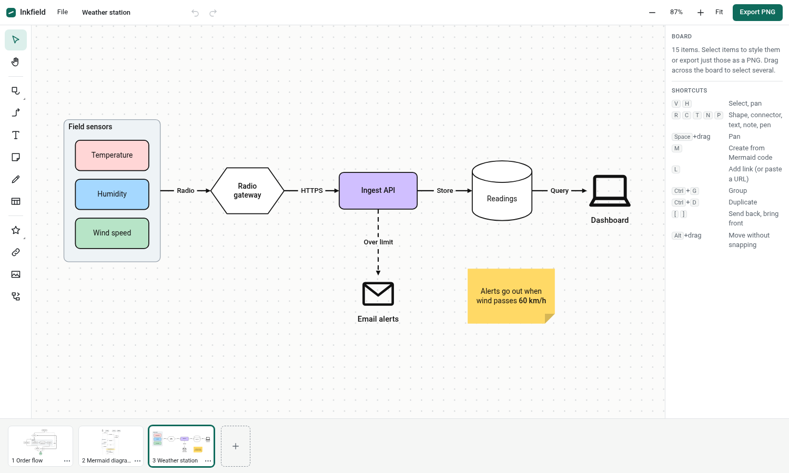
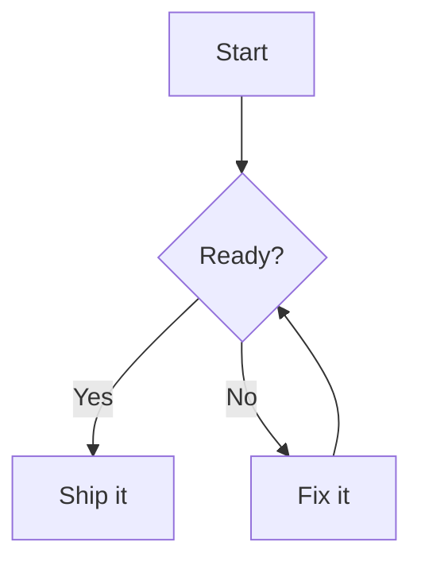

# Inkfield

An infinite-canvas diagram editor that runs in your browser. Keep separate whiteboards in one workspace or side by side in their own windows, draw diagrams from scratch, and export any selection of items as a PNG.



There is no account, backend or dependency to install. Your boards stay in your browser's storage.

## Run it

You need [Node.js](https://nodejs.org) 18 or newer.

```bash
git clone https://github.com/anonymousgroundhog/Inkfield.git
cd Inkfield
npm start
```

Then open <http://localhost:4173>. To use another port, run `PORT=5000 npm start`.

## What it does

- **Infinite whiteboard:** pan and zoom without limits. Scroll to pan, Ctrl+scroll to zoom, or hold Space and drag.
- **Multiple boards:** the strip along the bottom shows a live thumbnail of each board. Add, rename, duplicate, delete, or drag to reorder them.
- **Separate windows:** choose **Open in new window** from a board's `⋯` menu to work on two boards side by side. Windows stay in sync.
- **Diagramming tools:** shapes, text, sticky notes, tables, freehand pen, 30 built-in icons, and your own images (upload, drag in, or paste).
- **Connectors:** elbow, straight, or curved lines that stay attached when shapes move. They can have arrowheads and labels. Drag from the dots around a selected item to connect it.
- **Arrangement:** grouping (including nested groups), alignment guides while dragging, align and distribute commands, layering, undo and redo.
- **Mermaid import:** paste Mermaid code and get a diagram made of normal, editable shapes.
- **Link previews:** paste a URL to get a card with a thumbnail, title, and site name. YouTube links show the video's thumbnail.
- **PNG export:** select items, then choose **Export PNG**. You can set the scale (1× to 4×), padding, and a white or transparent background, then download the file or copy it to the clipboard.

### Exporting part of a board

1. Drag across the board to select a group of items, or Shift-click them. Clicking any item in a saved group selects the whole group.
2. Click **Export PNG**. The image is cropped to those items.
3. Connectors with both ends on selected items are included automatically. Clear **Include connectors between selected items** to leave them out.

### Text formatting

Wrap words in double asterisks for bold, such as `**Tip:** Save a backup`. This works in shapes, notes, table cells, and labels.

### Add links with previews

Paste a web address onto the canvas, drag one in from your browser, or press `L`. You can paste several at once, one per line. Double-click a card to open the link.

- **YouTube links** show the video's thumbnail, title, and channel. Watch, short, embed, live, and `youtu.be` links all work.
- **Other websites** show the page's preview image and title, if the site publishes them. Without an image, the card shows the title and site name only.
- **If a preview can't load**, the card still works as a link. Select it and choose **Refresh preview** to try again.

Thumbnails are saved inside the board, so cards keep working offline and export to PNG.

To load a preview, your computer contacts the linked site, and only when you add a link or refresh it. Opening an imported board file doesn't contact the sites it names. Previews skip addresses on private networks, and sites on ports other than 80 and 443.

Website previews need the local server started by `npm start`. If you host the files on a static host, only YouTube thumbnails load, without titles.

### Create a diagram from Mermaid code

Press `M`, click the Mermaid button in the left toolbar, or choose **File > Create from Mermaid**. Type or paste your code, check the live preview, and then choose **Add to this board** or **Create on new board**. You can also paste Mermaid straight onto the canvas or drop an `.mmd` file on it.



The diagram is laid out automatically and uses Inkfield's own shapes and connectors, so you can move, restyle, and export every part of it.

| Mermaid type | What converts |
| --- | --- |
| `flowchart` / `graph` | Directions, node shapes, link styles and labels, chained links, `&`, nested subgraphs, `style`, `classDef` |
| `sequenceDiagram` | Participants, actors, all arrow types, notes, `autonumber`, `alt`, `loop`, `opt`, `par`, `critical`, `break` |
| `stateDiagram-v2` | Start and end states, transitions, composite states, descriptions, choice, fork, join |
| `classDiagram` | Classes, members, relationships, cardinality |
| `erDiagram` | Entities, attributes, relationships (shown as text such as `1 : 0..*`) |

Other Mermaid types, such as Gantt and pie charts, show a message saying they aren't supported. If a line can't be read, the preview names it and the rest of the diagram still converts.

The conversion is an approximation of Mermaid's own output:

- The layout differs from Mermaid's.
- Shapes Inkfield doesn't have become the closest match. For example, trapezoids become parallelograms and double circles become circles.
- Class relationships use simple end markers rather than exact UML symbols.
- `linkStyle`, `click`, and sequence activation bars are ignored.
- In a sequence diagram, messages aren't attached to participants, so select everything before moving part of it.

### Keyboard shortcuts

| Keys | Action |
| --- | --- |
| `V` / `H` | Select / pan tool |
| `R` / `O` / `D` | Rectangle / ellipse / diamond |
| `M` | Create from Mermaid code |
| `L` | Add a link |
| `C` / `T` / `N` / `P` | Connector / text / sticky note / pen |
| `Enter` or double-click | Edit text |
| `Ctrl+Enter` or `Esc` | Finish editing text |
| `Ctrl+G` / `Ctrl+Shift+G` | Group / ungroup |
| `Ctrl+C` / `X` / `V` / `D` | Copy / cut / paste / duplicate (paste works across boards and windows) |
| `Ctrl+Z` / `Ctrl+Shift+Z` | Undo / redo |
| `[` / `]` | Send to back / bring to front |
| Arrow keys | Nudge 1 px (`Shift` for 10 px) |
| `Ctrl+1` / `Ctrl+0` | Fit to view / zoom to 100% |
| `Ctrl+Shift+E` | Export PNG |
| `Alt` while dragging | Move without snapping |

## Create diagrams from JSON

Boards are plain JSON, so scripts and AI assistants can write them too. Import a file with **File > Import JSON** or by dropping it on the canvas.

```json
{
  "name": "Login flow",
  "elements": [
    { "id": "user", "type": "icon", "icon": "user", "x": 0, "y": 0, "text": "User" },
    { "id": "api", "type": "rect", "x": 280, "y": 3, "text": "Auth API" },
    { "type": "connector", "from": "user", "to": "api", "label": "Sign in" }
  ]
}
```

| Type | Main fields |
| --- | --- |
| `rect`, `ellipse`, `diamond`, `hexagon`, `parallelogram`, `cylinder` | `x`, `y`, `w`, `h`, `text`, `fill`, `stroke`, `strokeWidth`, `dash`, `fontSize`, `fontWeight`, `align`, `valign`, `textColor` |
| `text`, `sticky` | `x`, `y`, `w`, `h`, `text`, `fontSize` |
| `icon` | `x`, `y`, `w`, `h`, `icon` (name from [`src/icons.js`](src/icons.js)), `text` (caption) |
| `table` | `x`, `y`, `w`, `h`, `cells` (array of rows), `titleRow`, `headerFill` |
| `connector` | `from` and `to` (an element id, or `{ "id", "side" }`, or `{ "x", "y" }`), `route` (`elbow`, `straight`, `curve`), `startCap` and `endCap` (`none`, `arrow`, `open`, `dot`, `cross`), `label` |
| `image` | `x`, `y`, `w`, `h`, `src` (base64 `data:image/...` only) |
| `link` | `x`, `y`, `w`, `h`, `url`, `title`, `kind` (`page`, `video`), `image` (base64 `data:image/...` only). Previews don't load automatically: select the card and choose **Refresh preview**. |

To preview a board or Mermaid file without a browser, render it to SVG. Text wrapping in this output is approximate:

```bash
node bin/render-svg.js examples/weather-station.json diagram.svg
node bin/render-svg.js examples/flowchart.mmd diagram.svg
```

## Where your data lives

Boards are stored in your browser's IndexedDB, so they belong to one browser on one device, and clearing site data deletes them. Use **File > Back up all boards** to keep a copy and **File > Import JSON** to restore it.

## Current limitations

- Items can't be rotated.
- There is no multi-user collaboration across devices. Windows sync only within the same browser, and if two windows edit the same board at the same moment, the last save wins.
- Connectors route by simple rules and don't steer around other items.
- Text uses system fonts, so a PNG can look slightly different on another computer.

## Development

The app is plain JavaScript modules with no build step. Rendering lives in one pure function ([`src/render.js`](src/render.js)) shared by the canvas, thumbnails, and export, so a PNG matches what's on screen.

```bash
npm test                     # unit tests
python3 tests/e2e/smoke.py   # browser tests, with npm start running (needs Python Playwright)
```

## License

[MIT](LICENSE)
